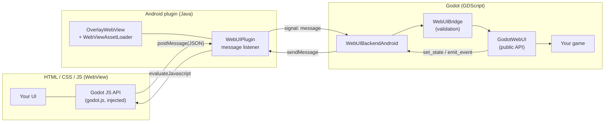

# Godot WebUI

Build game HUDs and menus with HTML, CSS and JavaScript while Godot keeps owning gameplay and game state.

Godot WebUI places a native Android `WebView` above your game as a transparent, touch-interactive overlay and connects it to GDScript through a small, validated message bridge.

> **Status: early (0.1.0), Android only.** Android is the only supported runtime. A desktop *development preview* exists to speed up UI iteration from the Godot editor; it is not a supported platform. There is no iOS backend. See [Limitations](#limitations) for what is and isn't verified.

## Overview

Web technologies are good at UI: layout, animation, typography, gradients and responsive design are cheap there and laborious with Godot `Control` nodes. AI coding agents are also fluent in HTML/CSS/JS. This addon lets you use that for game interfaces without moving any gameplay into JavaScript:

- **Page → Godot:** the page sends named events with JSON payloads (`Godot.emit("jump")`). Godot decides what they mean.
- **Godot → page:** Godot sends persistent **state** (`set_state`) and one-shot **events** (`emit_event`); the page renders them.

This differs from rendering HTML into a texture: the overlay is a real Android view. It receives real touches, multi-touch, pointer events and CSS `:active` states, and Godot continues to render the game behind it.

## Features

- Native Android `WebView` overlay, full-screen and transparent, managed by an Android plugin (Java, Godot plugin v2).
- Local HTML loading from a `res://` folder through `WebViewAssetLoader`; non-local requests and navigation are blocked.
- **Automatic export packaging:** the export plugin packages your UI folder(s) and the bridge script itself, no manual "non-resource files" filter needed, and reports misconfiguration in the export log.
- JavaScript → GDScript events with name and payload validation, a size limit (64 KB) and error signals.
- Godot → JavaScript **state** (`set_state`, latest value wins and is replayed to late subscribers) and **events** (`emit_event`, ordered, never replayed); both are held until the page is ready.
- Touch handling helpers: a pointer-capture pattern, and `Godot.guard()` to release held input on blur, page hide and app pause.
- Touch modes `AUTO` (default), `MODAL` and `REGIONS`; only elements marked `data-webui-touch` receive touches when pass-through is on.
- Page navigation within one UI folder (`load_page`), show/hide, shutdown, a `suspended` signal for app pause, a guard against a second overlay, and best-effort re-creation after the WebView renderer dies.
- Example: a physics character with an HTML menu (levels, settings, stats, about) and an HTML HUD (joystick, jump, attack, health, pause).
- Starter page in `templates/hud/index.html`.
- Optional desktop development preview (editor only): see [docs/desktop-preview.md](docs/desktop-preview.md).

Not every item has been verified on real devices; see [Limitations](#limitations).

## Architecture



| Part | Responsibility |
|---|---|
| **Web UI** | Rendering, animation, layout, buttons, joysticks, browser-side UI state |
| **Godot** | Movement, physics, rules, authoritative health/inventory/settings, handling page events |
| **Android plugin** | Creating the WebView, local content serving, touch routing, the bridge, lifecycle and cleanup |
| **Bridge** | JSON messages. Native checks size and type, `WebUIBridge` (GDScript) validates the schema. Pages can only trigger handlers you registered with `on()` |
| **Export plugin** | Adds the AAR, packages the UI files, diagnoses the export configuration |

Security measures in the native layer: a single `WebMessageListener` limited to the local origin and main frame (no `addJavascriptInterface`), network loads blocked, file and content access off, a CSP on served files, and no `INTERNET` permission requirement.

## Requirements and compatibility

| | |
|---|---|
| Godot | **4.7.1**. The native AAR is built against `org.godotengine:godot:4.7.1.stable`. Other versions, including 4.7.0 and 4.7.2, are untested. |
| Platform | **Android only** at runtime. Desktop is a development preview; iOS is not implemented. |
| Android | `minSdk` 24 (set by the plugin). Needs an Android System WebView that supports `WEB_MESSAGE_LISTENER` and `DOCUMENT_START_SCRIPT`; otherwise an `error("webview_too_old", …)` is emitted. |
| Export | Gradle-based Android export (*Use Gradle Build* plus the Android build template). The export log tells you if it is off. |
| Building the native plugin (optional) | JDK 17, Android SDK (platform 35, build-tools 35.0.1), internet access for Gradle. Uses Gradle 8.11.1 (wrapper) and Android Gradle Plugin 8.6.1; `androidx.webkit` 1.12.1 is added to exports automatically. |
| Toolchain confirmation | The versions above were used for the existing build. Whether other JDK/AGP/Gradle combinations work is unconfirmed. |

## Installation

The packaged plugin libraries are already in the repository, so you do **not** need to build the native plugin to use the addon.

1. Copy the folder `addons/webui/` into your project's `addons/` folder, keeping its layout (`*.gd`, `plugin.cfg`, `web/godot.js`, `bin/WebUI-debug.aar`, `bin/WebUI-release.aar`).
2. Enable the plugin: *Project → Project Settings → Plugins → godot-webui*. Its export plugin is what packages the UI and adds the native library, so Android exports without it will not work.
3. Install the Android build template: *Project → Install Android Build Template…* (creates `android/build`).
4. In *Project → Export → Android → Options*, turn **Use Gradle Build** on. (If it is off, the export log shows an error from WebUI explaining that the native plugin would be missing.)
5. Set up the Android SDK, JDK and keystore in *Editor Settings → Export → Android*, and install the matching export templates.
6. Put your UI in a folder such as `res://ui/` (see [UI assets and packaging](#ui-assets-and-packaging)) and use `GodotWebUI` as shown below.

You do **not** need to set the "non-resource files" export filter.

**Native plugin source vs. packaged artifacts:** `native/android/` is the Java/Gradle **source**. `addons/webui/bin/*.aar` are the **packaged artifacts** that the export plugin includes in your APK. Rebuild them only if you change the Java code (see [CONTRIBUTING.md](CONTRIBUTING.md)).

## UI assets and packaging

Godot does not export `.html`, `.css`, `.js` and similar files by default. The WebUI export plugin does it for you:

- **Which folders:** every folder (outside `addons/`, `android/` and `native/`, and not hidden) that directly contains an `.html` file, together with everything beneath it. To choose explicitly, set the project setting `webui/export/ui_folders` (an array of `res://` folders, shown in *Project Settings* with Advanced Settings on); when it is non-empty, auto-detection is skipped. HTML files directly in `res://` are never packaged automatically (that would package the whole project); the export log warns about them.
- **Which files:** all files in those folders are packaged as **raw files**, so HTML, CSS, JS, JSON, images (PNG, JPG, SVG, WebP…), fonts (TTF, OTF, WOFF2…) and media work. They are packaged unchanged and are not re-imported: Godot's `.ctex`/font conversions are not used for them. Godot's own `.import` and `.uid` files are skipped.
- **The bridge script** `addons/webui/web/godot.js` is always packaged.
- **At runtime** the UI folder is copied to `user://` once per `start()` (Android's WebView cannot read Godot's packed files), so very large UI folders add startup time.
- Reference files with **relative URLs**; remote URLs (CDNs, web fonts, analytics) are blocked by design. Bundle fonts and images in the folder.
- Keep the page background transparent (`html, body { background: transparent }`) so the game shows through.

The export log prints `WebUI export: packaged N UI file(s) from …` and reports problems; read it when something is missing. If you also use the manual non-resource filter, nothing is duplicated.

## Quick start

GDScript:

```gdscript
extends Node

var ui := GodotWebUI.new()
var health := 100

func _ready() -> void:
    add_child(ui)
    ui.error.connect(func(code: String, text: String) -> void: printerr(code, ": ", text))
    ui.page_ready.connect(_push_state)           # fires on every page load
    ui.on("jump", func(_payload: Dictionary) -> void: print("jump requested"))
    ui.start("res://ui")                          # loads res://ui/index.html

func _push_state() -> void:
    ui.set_state("hud", {"health": health, "max_health": 100})   # persistent value

func take_hit() -> void:
    health -= 10
    ui.set_state("hud", {"health": health, "max_health": 100})
    ui.emit_event("hit", {"damage": 10})          # one-shot notification
```

`res://ui/index.html`:

```html
<!doctype html>
<html>
<head>
  <meta name="viewport" content="width=device-width, initial-scale=1, user-scalable=no, viewport-fit=cover">
  <style>html, body { margin: 0; background: transparent; touch-action: none; }</style>
</head>
<body>
  <div id="hp">HP --</div>
  <button id="jump" data-webui-touch>JUMP</button>
  <script>
    Godot.touchRegions();   // opt in: only [data-webui-touch] elements take touches
    document.getElementById('jump').addEventListener('pointerdown', () => Godot.emit('jump'));
    Godot.onState('hud', (s) => { document.getElementById('hp').textContent = 'HP ' + s.health; });
    Godot.onEvent('hit', (e) => console.log('ouch', e.damage));
  </script>
</body>
</html>
```

`window.Godot` is injected automatically; do not add a script tag for it.

### State vs. events

| | `set_state(name, payload)` | `emit_event(name, payload = {})` |
|---|---|---|
| Meaning | "The value is now X" (health, settings, inventory) | "Something happened" (toast, hit flash) |
| Page side | `Godot.onState(name, fn)` (or `Godot.on`) | `Godot.onEvent(name, fn)` |
| Late subscriber / reload | Gets the latest value (resend it from `page_ready` after a reload) | Never replayed |
| Before the page is ready | Newest value per name is held | Up to 64 held in order, then `event_queue_full` |
| Page navigation | Held values are dropped | Held events are dropped |

`send(name, payload)` still works as a **deprecated alias of `set_state`** and `Godot.on` as an alias of `Godot.onState`, so existing projects keep running. New code should use the explicit names.

### GDScript API (`GodotWebUI`)

| Member | Purpose |
|---|---|
| `start(ui_dir, page = "index.html") -> bool` | Create the overlay and load a page. Returns `false` and emits `error` on failure. The node must be in the scene tree. |
| `is_started()`, `get_backend_name()` | Whether the overlay is running; `"android"`, `"desktop_preview"` or `"none"`. |
| `load_page(page)` | Navigate to another page of the same folder. |
| `on(name, callable)`, `off(name, callable)`, `clear_handlers()` | Register handlers for page events; the handler receives the payload `Dictionary`. Names starting with `webui.` are reserved. |
| `set_state(name, payload)`, `emit_event(name, payload = {})` | Godot → page, see above. `send()` is the deprecated alias of `set_state`. |
| `show_ui()`, `hide_ui()` | Toggle visibility. |
| `touch_mode`, `set_touch_mode(mode)` | `GodotWebUI.TouchMode.AUTO` (default), `MODAL`, `REGIONS`; see below. |
| `shutdown()` | Destroy the WebView (also done on `_exit_tree`). Safe to call repeatedly. |
| `is_ready` | `true` once the page's handshake has arrived. |
| Signals | `page_ready`, `event_received(event_name, payload)`, `error(code, text)`, `console_message(level, text)`, `suspended`, `recovered` |

### JavaScript API (`Godot`)

| Member | Purpose |
|---|---|
| `Godot.emit(name, payload?)` | Page → Godot. Name matches `^[A-Za-z][A-Za-z0-9_.:-]{0,63}$`; payload is a plain object under 64 KB. |
| `Godot.onState(name, fn)`, `Godot.onEvent(name, fn)`, `Godot.on(name, fn)`, `Godot.off(name, fn)` | Receive state / events from Godot; `on` is `onState`. A state handler is called at once with the latest value if one already arrived. |
| `Godot.guard(releaseFn)` | Runs `releaseFn` on window blur, page hide and native app pause. Returns an unregister function. |
| `Godot.touchRegions(selector?)` | Opt in to pass-through for everything outside the matching elements (default selector `[data-webui-touch]`). |
| `Godot.available`, `Godot.preview` | Native bridge present; running in the desktop preview. |

To avoid stuck input, use Pointer Events with `setPointerCapture`, release on `pointerup`, `pointercancel` and `lostpointercapture`, and register the release with `Godot.guard()`. The demo's `ui/hud.js` shows the pattern.

### Touch modes

| Mode | Behaviour |
|---|---|
| `AUTO` (default) | The overlay takes every touch until the page calls `Godot.touchRegions()`; from then on only the marked elements do and the rest reach your game. Each page load starts modal again. |
| `MODAL` | The overlay always takes every touch (menus, pause screens). |
| `REGIONS` | Pass-through is always on. If the page never calls `Godot.touchRegions()` nothing is touchable, and after 3 s the `error` signal reports `touch_regions_missing`. |

A page that forgets `touchRegions()` therefore works (modal) instead of being dead, and pass-through is something a page asks for explicitly.

### Resilience

- **Duplicate overlay:** only one overlay can exist (the native plugin owns one WebView). A second `start()` is refused with `error("overlay_already_active", …)`.
- **Cleanup:** `shutdown()` and leaving the scene tree destroy the WebView and release the native resources.
- **Renderer death:** when the native layer reports `render_process_gone`, `GodotWebUI` re-creates the overlay on the same page and restores the state sent with `set_state`, then emits `recovered` (at most 3 attempts per minute, then `recovery_failed`). This is best effort: it depends on Android reporting the failure, it has been exercised only against a fake backend, and it has **not been tested on a device**. Events are not restored.

## Example project

The repository root is a Godot project whose main scene is the demo (`examples/playable_character/main.tscn`).

1. Open the project in Godot 4.7.1.
2. Confirm the plugin is enabled, the Android build template is installed and *Use Gradle Build* is on (see [Installation](#installation)). The editor can rewrite `export_presets.cfg` while it is open, so change settings in *Project → Export*.
3. Connect an Android device with USB debugging and use *Run on device* (or export an APK).

What the demo shows:
- An HTML main menu (Play, Levels, Settings, Stats, About) over a Godot-drawn background. Settings and stats are owned by Godot and displayed by the page.
- An HTML HUD with a joystick, jump, attack (press and release), a Godot-driven health bar, and a "Hurt me" button that asks Godot to apply damage. A hazard in the level damages the player from the game side, and a pause card pauses the game in Godot.

On desktop, `GodotWebUI.start()` shows the UI only if the [desktop development preview](#desktop-development-preview) is set up; otherwise it reports `desktop_preview_missing_dependency` (or `unsupported_platform` outside the editor) and the demo character can still be driven from the keyboard: arrows or A/D to move, Space/Up/W to jump, X or J to attack (hold).

## Desktop development preview

To iterate on your UI without exporting, run the game from the Godot editor (F5 / F6) on Windows, macOS or Linux and see the HTML UI inside the running game, with reload when the UI files change. It needs the optional third-party [godot_wry](https://github.com/MingHuiLiu/godot_wry) extension, which is **not** included here and is installed **outside your project** (so it can never end up in an export). It is a **development aid, not a supported runtime platform**: mouse and keyboard only, no touch pass-through, no lifecycle events, and webview engines that differ from Android's. It has been run on one Windows machine with godot_wry v0.2.0 (UI, transparency, messaging and hot reload worked there); macOS, Linux and keyboard behaviour are unverified. Setup, differences and diagnostics are in [docs/desktop-preview.md](docs/desktop-preview.md).

## Project structure

```
addons/webui/                  Godot addon
  webui.gd                     GodotWebUI: public API
  webui_bridge.gd              Message validation/encoding (no platform code)
  webui_backend*.gd            Backend interface and factory; Android, desktop preview and null backends
  export_plugin.gd             Android export: AAR, UI packaging, diagnostics
  webui_export_scan.gd         Finds the UI folders to package
  web/godot.js                 Browser-side API, injected into the page
  bin/*.aar                    Packaged native plugin (debug and release)
docs/desktop-preview.md        Desktop development preview: setup, differences, diagnostics
native/android/                Gradle project: Java source of the native plugin
examples/playable_character/   Demo scenes, scripts and HTML UI (ui/)
templates/hud/                 Starter HTML page
tests/headless_test.gd         Headless test: bridge, demo flow, desktop preview backend
tests/api_test.gd              Headless test: state/events, touch modes, guard, recovery, UI folder detection
AGENTS.md                      Guidance for AI coding agents working in this repo
```

## Limitations

- **Android only.** No iOS backend exists, and desktop is a development preview only, not a supported runtime.
- **Verified:** the GDScript loads in Godot 4.7.1; both headless tests pass on desktop (they use fake backends, not a WebView); the native plugin compiles to AARs; real debug Android exports of isolated project copies package the UI files and the native plugin correctly and fail or warn clearly on the misconfigurations described above; and the first version of the demo ran on one Android device, where the overlay, transparency, input, state updates and menu/game navigation worked.
- **Not verified on device:** anything added after that device run, notably `AUTO` touch mode, `set_state`/`emit_event` on the real bridge, the duplicate-overlay guard and renderer-death recovery (the last cannot be triggered easily); also touch pass-through to a game that handles its own touches, a game-layer finger together with a HUD finger, pause/resume with held input, orientation changes, repeated page or scene transitions, release builds and minification, image/font/audio assets inside the real WebView (they package correctly, but loading them on a device was not run), notch and safe-area behaviour, and low-end device performance.
- **Compatibility:** only Godot 4.7.1 has been used.
- **Touch pass-through** is decided at touch-down from element bounding boxes reported by the page (refreshed about every 200 ms), not per pixel. A gesture that starts on the HUD stays with the WebView.
- **One overlay at a time:** the native plugin holds a single WebView.
- **Recovery** after a dead WebView renderer is best effort and untested on a device (see Resilience).
- **Not implemented:** Android Back button handling, text input and on-screen keyboard handling, gamepad or focus navigation inside the page.
- **Startup:** the first WebView start took roughly 0.8 s on the tested device.
- The overlay sits above the game surface; Godot cannot draw over it. The WebView cannot blur the game behind it, so `backdrop-filter` has no effect on the game.

## Troubleshooting

| Symptom | Cause and fix |
|---|---|
| `missing_script`: `godot.js could not be read` | The godot-webui plugin was not enabled when exporting (its export plugin packages the script and the UI). Enable it under *Project Settings → Plugins* and export again. |
| `bad_ui_dir` / `stage_failed` (UI folder or file missing at runtime) | The UI folder was not packaged. Check the export log line `WebUI export: packaged N UI file(s) from …`; the folder must contain an `.html` file and live outside `addons/`, or be listed in `webui/export/ui_folders`. |
| Export log: "no UI folder found to package" | No folder with an `.html` file was found. Move your pages into a folder, or set `webui/export/ui_folders`. |
| Export log: "Use Gradle Build off" | Turn on *Project → Export → Android → Options → Gradle Build → Use Gradle Build* and install the Android build template. |
| Export fails with `Can't open file ... libgodot_wry.so` or the log says `res://addons/godot_wry is inside the project` | godot_wry was installed into the project. Move it out (see [docs/desktop-preview.md](docs/desktop-preview.md)); an export plugin cannot stop Godot from packaging an extension that is inside the project. |
| `plugin_missing` ("Android plugin 'WebUI' not found") | Use Gradle Build, install the Android build template, make sure the *godot-webui* plugin is enabled and `addons/webui/bin/*.aar` exist, and run through *Run on device* or an export. |
| `Nonexistent function 'new' in base 'JNISingleton'` | The native plugin registers a singleton named `WebUI`. Use the class `GodotWebUI`, not `WebUI`. |
| `overlay_already_active` | Another `GodotWebUI` is running; call its `shutdown()` first. |
| `touch_regions_missing` | `TouchMode.REGIONS` is set but the page never called `Godot.touchRegions()`. Call it, or use `AUTO`/`MODAL`. |
| `desktop_preview_missing_dependency` on desktop | The optional godot_wry extension is not installed outside the project. See [docs/desktop-preview.md](docs/desktop-preview.md). |
| `unsupported_platform` on desktop | Expected outside the editor: only Android is supported at runtime. |
| Export settings keep reverting | The editor rewrites `export_presets.cfg` while the project is open. Change settings in *Project → Export*, not in the file. |
| `webview_too_old` | Update Android System WebView on the device. |
| `blocked_request` or `blocked_navigation` | The page tried to load a non-local URL. Everything must be served from the UI folder. |
| `Typed UAV Load Additional Formats` error in the Windows editor | Your GPU lacks a D3D12 feature. Set *Rendering → Rendering Device → Driver → Windows* to `vulkan`. Unrelated to this addon. |

## Contributing and license

See [CONTRIBUTING.md](CONTRIBUTING.md) for setup, tests and how to rebuild the native plugin, [SECURITY.md](SECURITY.md) for reporting vulnerabilities, and [CHANGELOG.md](CHANGELOG.md) for changes.

**License:** not yet chosen. No license file is present in this repository.
